# Daybook screenshots (claude-project-thread-ctkmy2, bc4549d)

## 01-month

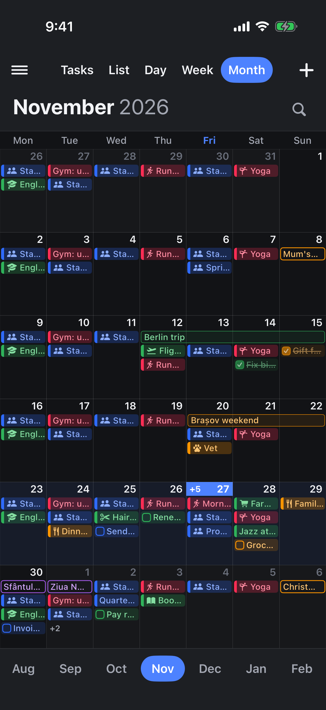

## 02-week

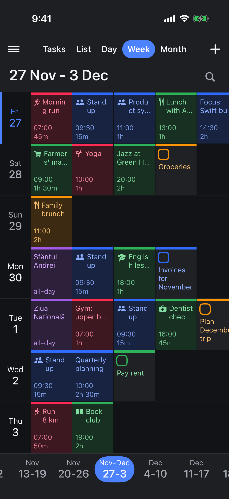

## 03-day

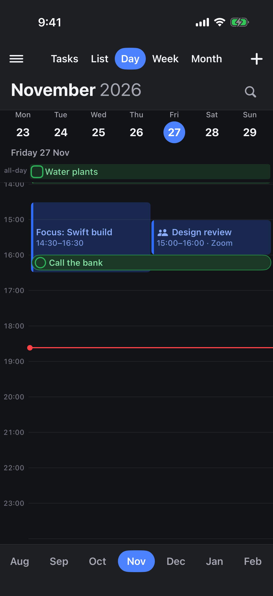

## 04-list

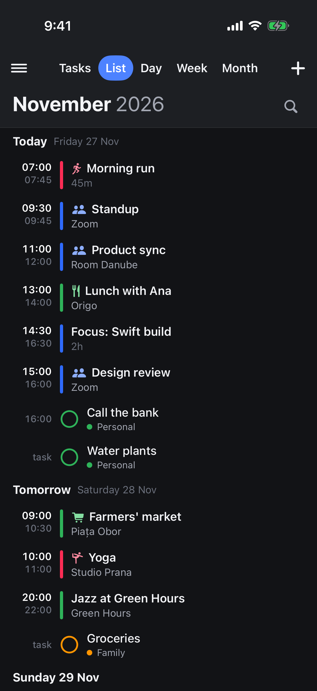

## 05-tasks

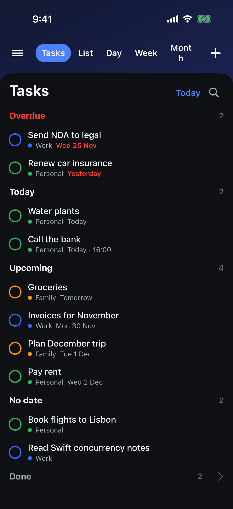

## 06-event-detail

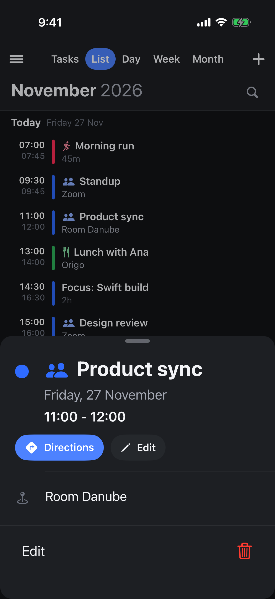

## 07-edit-event

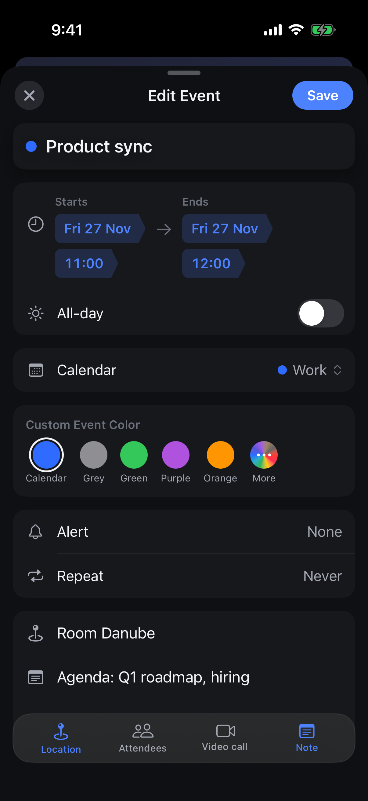

## 08-edit-event-wheels

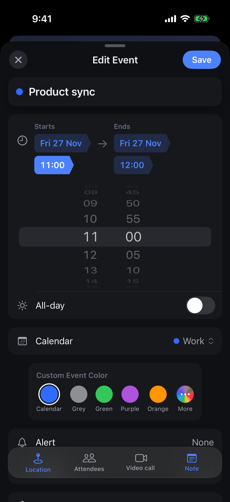

## 09-new-event-parsed

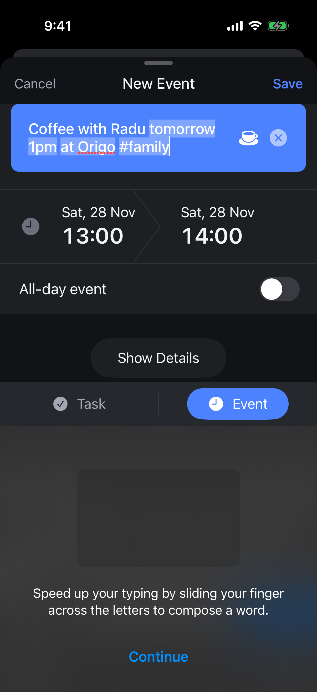

## 09a-new-event-empty

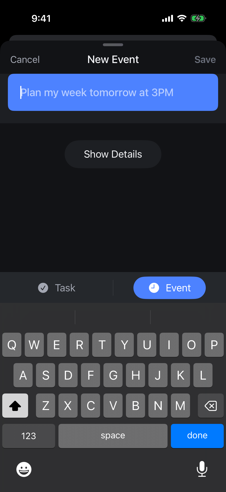

## 10-month-after-save

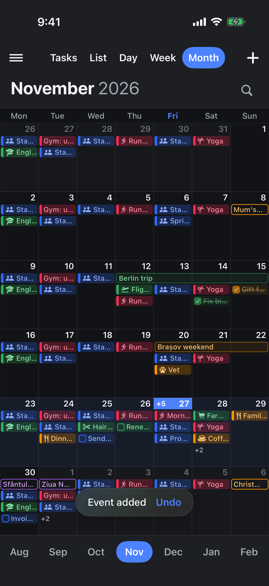

## 11-drawer

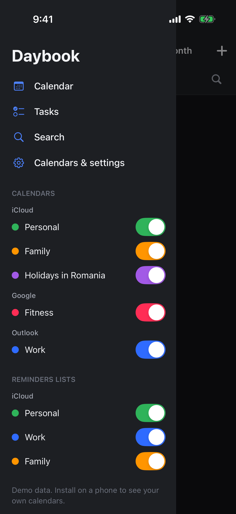

## 12-settings

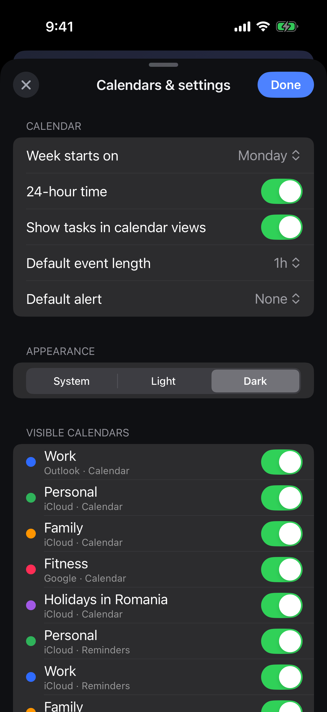

## 13-search

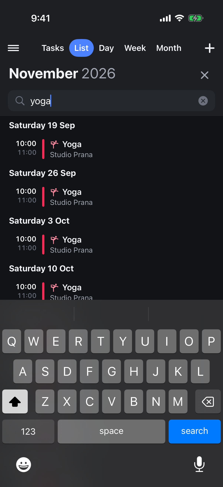

## 14-task-completed

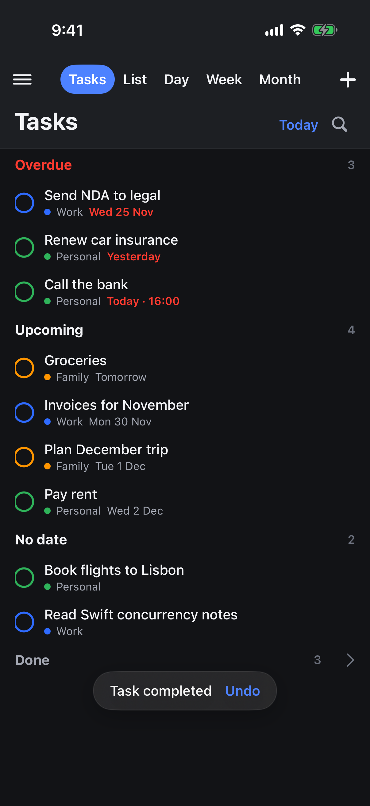

## 15-month-light

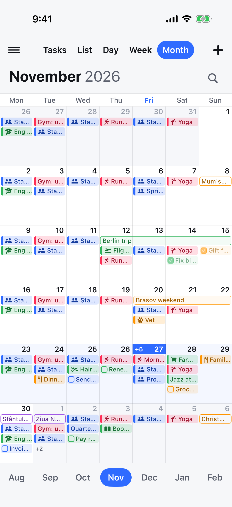

## 16-day-light

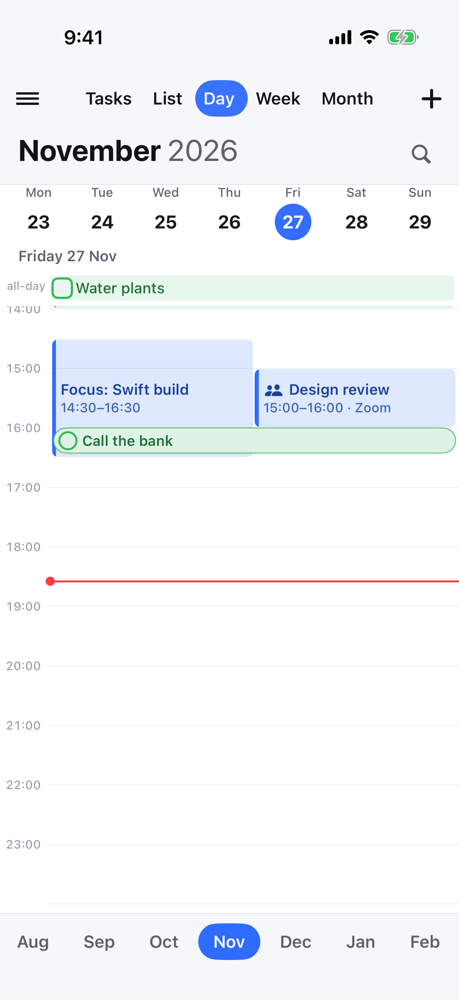

## 17-task-swiped

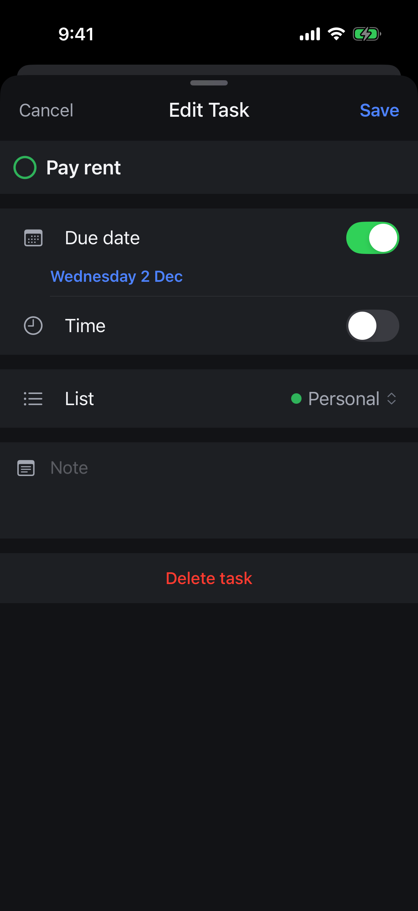

## 18-event-swiped

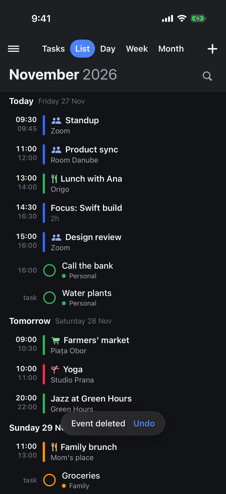

## 19-week-after-drag

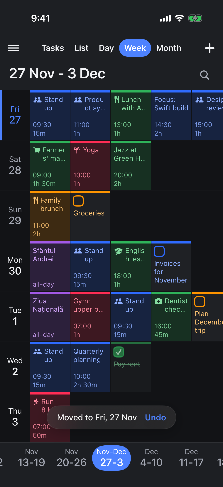

## 20-day-after-zoom

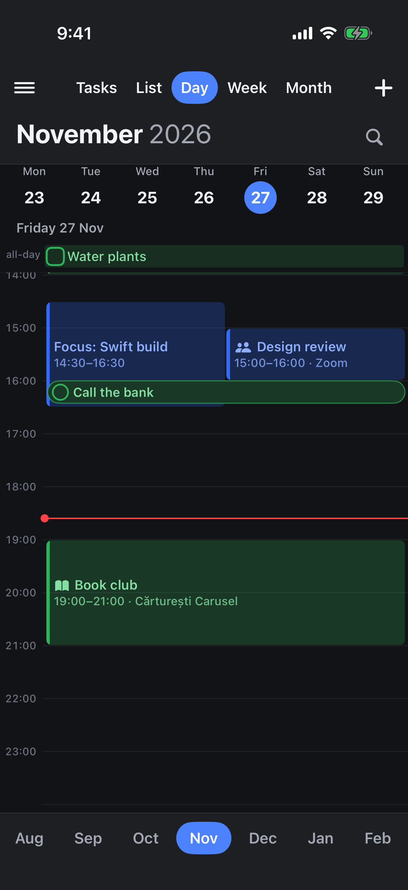

## 21-month-peek

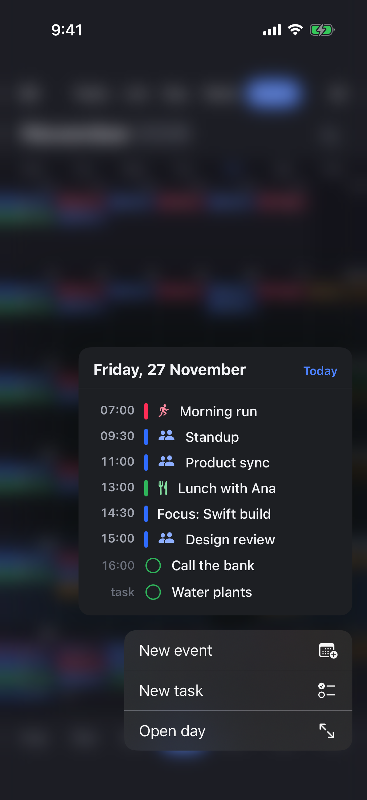
